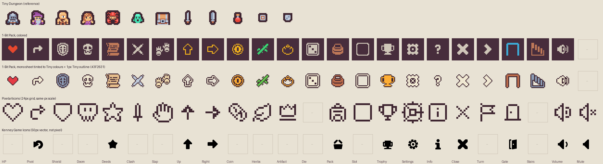

# Pixel UI icon set

Research for [#20](https://github.com/danielbank/shenanyrinth/issues/20), part of map [#1](https://github.com/danielbank/shenanyrinth/issues/1).
Researched 2026-11-07. This builds on [Free art and sound assets](https://github.com/danielbank/shenanyrinth/blob/research/free-art-and-sound-assets/research/free-art-and-sound-assets.md) (#4), which picked the Kenney "Tiny" family for the game art.

**Question.** Which single, consistent pixel-art icon set should the HUD and menus use, so it sits well next to the Kenney Tiny sprites (16×16, thick dark outlines) at ×2/×3 with `image-rendering: pixelated`? The [screen layout prototype](https://github.com/danielbank/shenanyrinth/issues/19) currently mixes sprites, Unicode glyphs, an emoji and CSS shapes.

**Method.**
- I read each licence on the asset's own page (kenney.nl, the GitHub repo, OpenGameArt, itch.io).
- I downloaded the Kenney zips into a scratch folder and read each bundled `License.txt`.
- I opened the tilesheets at ×3 with a coordinate grid and looked for every glyph in the ticket.
- For Pixelarticons I read the licence and file list through the GitHub API, and rasterised the SVGs.
- Nothing downloaded is in the repo, except one comparison PNG I made (see [Style check](#style-check)).

## Recommendation

Use the **Kenney 1-Bit Pack**, using its **monochrome-transparent** sheet.

- **Licence:** CC0, credit optional.
- **Grid:** the same 16×16 grid as Tiny.
- **Coverage:** **21 of the 24 glyphs** fully, 2 more partly. Nothing else checked comes close on the 16px grid.
- **Extras:** digits 0–9, A–Z, `+ − × ÷ = % : .`, and dice faces blank through 6.
- **Style:** solid one-colour glyphs. All 23 glyphs I mapped have at least 1px of empty margin. That means we can tint each glyph to a Tiny palette colour and add Tiny's 1px dark outline (`#3F2631`) without clipping. Done that way, filled glyphs (heart, coin, shield, trophy, bag) look like they came from the Tiny packs. See the comparison image below.

**What we draw ourselves (3 small 16×16 glyphs):**

1. **Mute.** Take the speaker (`37,16`) and add a small ×.
2. **Open hand (slap).** The pack only has gloves or paws (`41,0`, `39–42,1`). They read as "gloves", not a slap. Draw one open palm.
3. **Info "i".** The pack has `?` and `!` (`37,13`, `35,13`) and a letter `I` (`42,18`), but no "i in a circle". `?` may be good enough; otherwise draw one.

Optional: a **star** for Deeds if the scroll (`33,15`) doesn't read well. The pack has no five-point star.

**How to use it.**
- Slice the glyphs we need from `Tilesheet/monochrome-transparent_packed.png`. This is 784×352 px: 49×22 tiles of 16px with no spacing, so tile (c, r) sits at `x = c·16`, `y = r·16`.
- Bake each glyph once into a small HUD sheet: tint it to a Tiny palette colour and add the 1px `#3F2631` outline.
- Show it at ×2/×3 with `image-rendering: pixelated`, the same as the world sprites.
- Pre-baking avoids relying on CSS `mask-image` or `filter` to tint and outline at runtime. I did **not** verify whether those keep pixels crisp under `pixelated` scaling in all browsers.

**Runner-up: Pixelarticons** (MIT). It is a cleaner, more modern UI set and covers 19 + 2 partial glyphs.
- It sits on a **24×24** grid, so at the same pixel size its icons are 1.5× the size of a Tiny tile.
- It is outline-only, line-art style.
- It has no dice, Stairs or crossed swords.

Pick it only if the HUD is meant to look like a separate modern overlay, not part of the Tiny world.

## Candidates

Coverage is counted against the 24 entries in #20: HP, Pivot, Sway (shield), Resist (shield), Doom, Deeds, Clash, slap, 4-way arrows, Gold coin, Herbs, Artifact, dice, Pack, Slots, Trophy, settings, info, close, turn marker, Gate, Stairs, volume, mute. "✓+~" means full plus partial matches.

| Set | Licence (where verified) | Grid | Coverage | Style vs Tiny | Source |
|---|---|---|---|---|---|
| **Kenney 1-Bit Pack** | CC0. The page says "Creative Commons CC0". The bundled `License.txt` (it says v1.2; the page says 1.0) gives CC0 1.0, with credit "not mandatory". | 16×16. 1,078 tiles, 49×22 sheet; `Tilesheet.txt` gives 16px tiles. | **21 ✓ + 2 ~**, 1 missing (mute) | Same grid. Flat, outline-free one-colour glyphs, made for a dark background (`#472D3C`, close to Tiny's outline `#3F2631`). Ships a mono sheet you can tint. With a tint and a 1px dark outline it matches well. | [kenney.nl/assets/1-bit-pack](https://kenney.nl/assets/1-bit-pack) |
| Pixelarticons (free set, 1,036 icons) | MIT. The repo `LICENSE` reads "MIT License, Copyright (c) 2019 Gerrit Halfmann", and the GitHub API reports `MIT`. The README says "Every icon stays MIT licensed". The paid Pro set on pixelarticons.com is separate, so don't use it. | **24×24** ("drawn on a strict 24×24 grid"), SVG, `fill="currentColor"` | **19 ✓ + 2 ~** (herbs = `leaf`, Gate = `door-closed`). Missing: crossed swords (only one `sword`), dice, Stairs. | Monochrome and easy to tint (currentColor). Outline line-art with 1px strokes and no fill. The grid doesn't match: a 24px icon is 1.5× a Tiny tile at the same pixel scale. It looks like a crisp "app" icon set rather than a game sprite. | [github.com/halfmage/pixelarticons](https://github.com/halfmage/pixelarticons) |
| Kenney Game Icons (non-pixel control) | CC0. The page says "Creative Commons CC0", as does the bundled `license.txt`. | Vector. 50px and 100px PNGs plus SVG. 105 assets. | **9 ✓ + 2 ~**: `return` (Pivot), `star`, arrows, `trophy`, `gear`, `information`, `cross`, `audioOn`, `audioOff`, plus `basket` and `door` as partials. No heart, shield, skull, swords, coin, dice or Stairs. | Not pixel art: smooth, bold silhouettes. Clearly off next to Tiny, as expected. | [kenney.nl/assets/game-icons](https://kenney.nl/assets/game-icons) |
| Kenney UI Pack – Pixel Adventure (v2.0) | CC0. The page says "Creative Commons CC0". The bundled `License.txt` says "UI Pack - Pixel Adventure (2.0) License: (Creative Commons Zero, CC0)". | 16×16 "Small" and 32×32 "Large" tiles, each in thick and thin outline versions. 161 tiles per variant. | **2 ✓ + 2 ~**: close (× on a round button), Slots, and as partials `!` for info and N/E/S/W letter and pointer shapes for arrows. | The closest look to Tiny (thick dark outline, brown and slate), but it is a **frames and buttons** pack, not an icon set. Already chosen in #4 for panels. | [kenney.nl/assets/ui-pack-pixel-adventure](https://kenney.nl/assets/ui-pack-pixel-adventure) |
| Kenney Pixel UI Pack (2015) | CC0. The page says "Creative Commons CC0". The bundled `License.txt` says "License (Creative Commons Zero, CC0) … Credit … not mandatory". | No fixed icon grid. One 538×592 sprite sheet of buttons, 9-slices and small glyphs. | **4 ✓ + 1 ~**: arrows, close (× box), Slots, turn marker (pointer), plus pointing-hand cursors for slap. | Bright, flat "mobile game" colours. Not RPG. | [kenney.nl/assets/pixel-ui-pack](https://kenney.nl/assets/pixel-ui-pack) |
| Kenney Micro Roguelike | CC0 (page and bundled `License.txt`) | **8×8**, 320 files | Not counted in full. It is the 8px little sibling of 1-Bit and has hearts, skulls and coins. | Half the grid size, so it would need ×2 relative to Tiny and would look chunkier. | [kenney.nl/assets/micro-roguelike](https://kenney.nl/assets/micro-roguelike) |
| Kenney Tiny Battle / Tiny Dungeon / Tiny Town | CC0 (from #4, and the bundled `License.txt` files I re-read) | 16×16 | About 4 ✓: heart and digits (Tiny Battle), shields and swords (Tiny Dungeon), coin (Tiny Town). No UI glyphs (gear, close, volume, arrows, dice). | Exact match, but these are world sprites, not a UI set. They can stand in for HP, shield or coin if we want those to be literally in-world items. | from #4 |
| Kyrise's Free 16x16 RPG Icon Pack | **CC-BY 4.0** (OGA page: "Creative Commons Attribution 4.0 International") | 16×16, black outline | Items only (weapons, potions, food); no UI glyphs | Close in look, but needs credit, and an OGA commenter flagged a related pack of hers for including another artist's icons. Avoid. | [opengameart.org/content/kyrises-free-16x16-rpg-icon-pack](https://opengameart.org/content/kyrises-free-16x16-rpg-icon-pack) |
| iD01t "RPG Pixel Art Icon Pack" | The page says "CC0 (Public Domain)", but the pack costs $2.99 CAD and is marked "AI Assisted" | 16×16, 33 icons | Heart, shield, coin and a few UI pieces; no skull | Too small a set, and the AI-assisted origin makes it a provenance risk. Avoid. | [id01t.itch.io/rpg-pixel-art-icon-pack](https://id01t.itch.io/rpg-pixel-art-icon-pack) |

Kenney licence, general: "public domain licensed (CC0)… Attribution is not required", and don't use Kenney's logo ([kenney.nl/support](https://kenney.nl/support), quoted in #4).

## 1-Bit Pack glyph map

Coordinates are `column,row` on the 49×22 packed sheet (16px tiles, no spacing). ✓ = good match, ~ = usable stand-in, ✗ = draw it.

| Glyph | Tile(s) | Match |
|---|---|---|
| HP / heart | `39,10` filled heart (`40–42,10` outline and broken hearts; `25,21` outline heart) | ✓ |
| Pivot (turning arrow) | `20,20` bent "turn right" arrow (`19,20`, `21,20`, `22,20` other turns) | ✓ |
| Sway / Resist (shield) | `37,3`, `38,3`, `39,3`, `37,4`, `38,4`, `39,4`, `40,4`: seven different shields, so Sway and Resist can have distinct shields | ✓ ✓ |
| Doom / skull | `38,11` (also `34,12`; `36,15` skull speech bubble) | ✓ |
| Deeds (star or scroll) | `33,15` / `34,15` scroll (no star) | ✓ (scroll) |
| Clash / crossed swords | `30,11` two crossed blades | ✓ |
| slap / open hand | `41,0`, `42,0` paired paws or gauntlets; `39–42,1` gloves | ~ |
| 4-way arrows | outline `28–31,20`; filled `28–31,21`; chevrons `24–26,20`; big up arrow `24,12` | ✓ |
| Gold coin | `41,3` coin; `41,4` coin stack; `35,16` `$` | ✓ |
| Herbs | `33,20` green sprig; `15–17,6` plants | ✓ |
| Artifact | `43,2`, `44,2` crowns; `43–46,6` rings; `43–46,7` amulets | ✓ |
| dice | `39,14`/`39,15` blank face; `42–47,14` and `42–47,15` faces 1–6 (two border styles); `40,14` × face, `41,14` skull face | ✓ |
| Pack / bag | `46,4` sack; `47,4` backpack | ✓ |
| Slots | `39,14` blank square; `41,13` rounded frame | ✓ |
| Trophy | `40,16` | ✓ |
| settings | `45,16` gear | ✓ |
| info | `37,13` `?`; `35,13` `!`; `36,13`/`38,13` in speech bubbles | ~ |
| close | `40,13` × | ✓ |
| turn marker | `24,20` chevron; `27,20` ring; `39–42,12` hourglasses | ✓ |
| Gate | `2,9` arched gateway; `0,9`, `1,9` doors; `4,9`, `5,9` wooden doors | ✓ |
| Stairs | `2,6` staircase; `21,1` ladder | ✓ |
| volume | `37,16` speaker; `38,16` speaker with waves | ✓ |
| mute | none | ✗ |

Useful extras: digits `35–44,17`, letters A–Z `35–47,18` and `35–47,19`, math signs `35–40,20`, card suits, music note `39,16`, house `41,16`, keys `32–34,11`, potions `39–42,11` and `32–34,13`.

## Style check

The image is [`pixel-ui-icon-set-comparison.png`](pixel-ui-icon-set-comparison.png). Each row shows the same glyph columns at ×3. Rows from top:
1. Tiny Dungeon sprites, as the reference.
2. 1-Bit Pack, coloured sheet, on its native dark background.
3. 1-Bit Pack, mono sheet tinted to Tiny colours and given a 1px `#3F2631` outline by script.
4. Pixelarticons rasterised from its SVGs at the same pixel scale.
5. Kenney Game Icons at their native 50px.

What I saw:

- **1-Bit, coloured, as shipped.** These are single-colour silhouettes with no outline, in cream, orange, gold, green and blue. They are drawn for the dark `#472D3C` background. On a light background the cream glyphs nearly vanish. Next to Tiny they look flatter and lighter, because Tiny sprites are multi-colour with a dark outline. Usable on a dark HUD panel as-is.
- **1-Bit, tinted and outlined (recommended treatment).** Filled shapes look close to native Tiny sprites: the heart, coin, shield, trophy, bag, Gate and Stairs. The shared outline colour and grid make them read as one family. Thin line-art glyphs look slightly spindly next to the chunkier Tiny sprites: the skull, swords, gear and `?`. They are still clear at ×3. Every 1-Bit glyph I checked has at least 1px of empty margin inside its 16px tile (by bounding box), so the outline never clips.
- **Pixelarticons.** These are crisp and consistent, but noticeably **bigger** than a Tiny tile at the same pixel scale, because of the 24px grid. Their hollow 1px-stroke line art reads as "app UI" rather than "game sprite". As a set they look tidy; as neighbours to Tiny they look like a different game.
- **Kenney Game Icons.** Smooth, anti-aliased, bold vector shapes. Clearly not pixel art. This confirms the control: don't mix it in.

## Open questions

- **Tint and outline at runtime or at build time?** I recommend a one-off baked HUD sheet, made by a small script or by hand in an editor. CSS `mask-image` tinting under `image-rendering: pixelated` was not verified.
- **Should the HUD use world sprites for HP, shield and coin** (Tiny Battle's heart, Tiny Dungeon's shields, Tiny Town's coin) and 1-Bit only for abstract glyphs? That makes them more "in-world", but mixes two sources. The tinted 1-Bit set alone is more uniform.
- **Star or scroll for Deeds?** That's a design call. 1-Bit only has the scroll.
